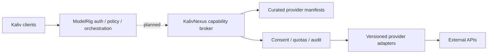

# Kaliv ecosystem and KalivNexus integration

Documentation snapshot: 2026-10-23. This document is an integration map, **not** a production acceptance statement. For executable configuration and release gates, consult the component-specific runbooks and exact-revision evidence.

## Ownership map

| Component | Responsibility | Integration boundary |
| --- | --- | --- |
| [ModelRig](https://github.com/Ternedal/ModelRig) | Authenticated backend, memory, cognition, policy, tool authorization | Coordinates but does not absorb subsystem identity authority |
| [Kaliv](https://github.com/Ternedal/Kaliv) | Public product website; Kaliv clients are separate runtime surfaces | Clients access approved backend APIs |
| [KalivNexus](https://github.com/Ternedal/KalivNexus) | **Proposed** external API discovery and capability broker | Design/bootstrap; no verified production integration |
| [VoiceRig](https://github.com/Ternedal/VoiceRig) | Voice profiles and synthesis | ModelRig provides authenticated facade and fallback |
| [VisionRig](https://github.com/Ternedal/VisionRig) | Structured sensor/perception events | Observations alone do not authorize memory or actions |
| [BodyRig](https://github.com/Ternedal/BodyRig) | Body identity, BodyPrint and motor state | Renderers consume authorized motor state |
| [LanguageRig](https://github.com/Ternedal/LanguageRig) | Danish language-model adaptation | Training/evaluation is separate from ModelRig serving |
| [KalivHub](https://github.com/Ternedal/KalivHub) | Home Assistant dashboard/Cast sender | Explicit allowlisted state exposure |
| [KalivHub-Receiver](https://github.com/Ternedal/KalivHub-Receiver) | Display-only Cast receiver | Must not hold Home Assistant credentials |
| [SkyPlayer-Engine](https://github.com/Ternedal/SkyPlayer-Engine) | Shared XR/media primitives | Engine is not the release authority |

## Proposed Nexus path

Nexus must default-deny unapproved integrations. The external [API-mega-list](https://github.com/cporter202/API-mega-list) is discovery input, not a trusted registry. Never automatically activate catalog entries. Require explicit approval for side effects, bounded timeouts/retries/costs, secret isolation, SSRF/egress protection, response validation and redacted audit records. Nexus must not independently write durable memory or bypass ModelRig tool policy.

## Release and media rules

- Separate **proposed**, **implemented**, **automated-test verified**, **physically tested** and **released** statuses.
- Pin exact repository revisions and capture test hardware, results and unresolved gates.
- Generated images and videos belong on configured external media storage; clients must use authenticated media retrieval rather than assuming shared filesystem paths.
- A documentation-only change does not alter runtime feature flags, system release status or production activation.

## Repository-specific verification backlog

- [ ] Confirm current runtime API contracts, authentication and ports against source.
- [ ] Verify install, update, rollback, disaster recovery and troubleshooting procedures.
- [ ] Confirm current release evidence on exact SHAs across subsystem repositories.
- [ ] Add versioned Nexus adapter and manifest contracts **after** implementation.
