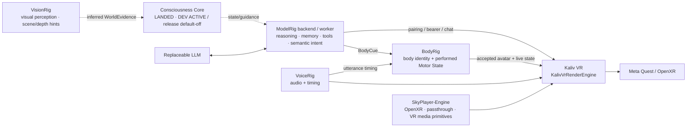

# Kaliv VR

Kaliv VR is the third first-party ModelRig client, alongside `android/` and `desktop/`.

It is a Unity/OpenXR client for Meta Quest. It talks to the same ModelRig backend and uses the same pairing/token model as the other Kaliv clients. VR playback, projection and passthrough mechanics come from the separate `Ternedal/SkyPlayer-Engine` package.

For the whole-product context, see [`docs/KALIV_SYSTEM_DEFINITION.md`](../docs/KALIV_SYSTEM_DEFINITION.md). Kaliv VR is the embodied presentation surface; it does not move body, voice or cognition authority into the renderer.

## Architecture



The product boundary is deliberate:

- **ModelRig / Kaliv VR** owns pairing, auth, model selection, Kaliv UX and the Quest presentation/rendering engine.
- **BodyRig** owns body identity and performed body-state semantics.
- **SkyPlayer-Engine** owns reusable XR/media mechanics.
- **Skyplayer** remains a separate Stash-oriented client of the same engine.

## Current landed scope

The landed first-party VR slice provides:

- code-driven XR rig; no hand-authored scene dependency
- Kaliv dark/gold world-space UI foundation
- controller-ray + gaze fallback interaction
- ModelRig `POST /api/v1/pair/claim`
- bearer-token persistence in Unity PlayerPrefs for bootstrap development
- `GET /api/v1/models`
- streaming `POST /api/v1/chat` over NDJSON, with a stop control and partial-answer commit
- the shared stream contract (`KalivStreamContract`), ported from Android and covered by tests
- SkyPlayer-Engine dependency pinned to an exact revision
- Quest/Android build script using IL2CPP + ARM64 + GLES3
- BodyRig VRM avatar loading with body/package/member-digest binding
- live `bodyrig.render_frame` v0.1 rendering
- BodyPrint height-scale presentation
- automatic active-body revision reload
- verified authored `idle.vrma` / `talk.vrma` state motion
- explicit persistent Body / Media / UI / Debug composition roots
- Kaliv-owned media facade over SkyPlayer-Engine with flat/VR180/VR360 projection bound to `KalivMedia`
- tracking-origin compensation propagated into immersive media orientation

The implementation is landed on `main`, but it is not yet a physically qualified finished VR product. Voice, RAG, tools/confirmation, richer spatial interaction and the rest of the Kaliv conversation UX still need parity with Android/Desktop, and Quest device evidence remains its own gate.

## The stream contract

`Assets/Scripts/KalivStreamContract.cs` is a deliberate port of the Android client's `StreamContract.kt`, not a VR-specific re-invention. Three clients read the same wire format; if they disagree about what a finished answer is, they disagree about whether the user got a whole one.

The rule that carries the weight: **a body running out is not completion.** A proxy timeout, a dropped link and a crashed upstream all end the response body exactly the way a finished answer does, so a truncated reply looks complete unless a terminal event was actually seen. `TerminalFailure(sawTerminal, sawContent)` turns an exhausted stream into one of three outcomes — a real completion, an answer cut short, or an answer that never started — because those are different things to the person reading the screen, and none of the last two is success.

Three parsing details are regressions, not decoration:

- A bare `{"error": "..."}` line has no `message.content`, so a naive reader scores it as an empty delta and drops it. That is how an error once ended a turn with nothing on screen.
- A terminal line may carry the last token in `message.content`. Dropping it truncates the answer by a word.
- A `phase` is not content, so a stream that announced a phase and then died reads as empty rather than truncated.

Voice events (`transcript` / `chunk`) in the Android contract are intentionally **not** ported yet: VR has no voice turn to feed them to, and the parser should not run ahead of a consumer.

Tests live in `Assets/Tests/KalivStreamContractTests.cs` (17 EditMode cases, mirroring the Android suite).

## Assembly definitions

`Assets/KalivVr.asmdef` and `Assets/Editor/KalivVr.Editor.asmdef` are load-bearing, not tidying.

`IAwaitCaller` and `RuntimeOnlyAwaitCaller` live in `UniGLTF.Utils`, which sets `"autoReferenced": false`. With no asmdef under `vr/Assets/`, everything landed in `Assembly-CSharp`, which only gets automatic references to auto-referenced assemblies — so those types were invisible and a **clean checkout did not compile** (CS0246/CS0012 in `KalivVrmAvatarLoader` and `KalivVrmaMotionController`). Note that a compile error in an assembly also removes the menu items defined in it, which is why `Kaliv VR → Build Android APK` disappears rather than failing loudly.

## Build

Open `vr/` in Unity **6000.4.10f1** with Android Build Support.

Use **Kaliv VR → Build Android APK** for an interactive editor build.

`KalivVrBuild.BuildAndroid` detects batch mode and exits with the build result, so it can also be driven headless — which is what to prefer for a full build. The first Android build of this project is long (IL2CPP converts ~400 translation units, roughly 2½ hours on a warm shader cache), and a headless run has no editor window that can be closed out from under it:

```powershell
$unity = "C:\Program Files\Unity\Hub\Editor\6000.4.10f1\Editor\Unity.exe"
& $unity -batchmode -nographics -projectPath vr `
    -buildTarget Android `
    -executeMethod Kaliv.VR.EditorTools.KalivVrBuild.BuildAndroid `
    -logFile vr\release\build.log
```

Exit code 0 means the APK exists; the log ends with `[KalivVR] BUILD OK`. Note that `ExitCode: 4` lines from `bee_backend.exe` in that log are normal dag regeneration, not failures.

Run the EditMode tests the same way:

```powershell
& $unity -batchmode -nographics -projectPath vr `
    -runTests -testPlatform EditMode `
    -testResults vr\release\testresults.xml -logFile vr\release\test.log
```

For the exact-head physical gate from the repository root on Windows:

```powershell
$sha = (git rev-parse HEAD).Trim()
.\scripts\run-kaliv-vr-quest-validation.ps1 -ExpectedSha $sha -Install -Launch
```

Omit `-Install -Launch` when only package restore / C# compile / Android IL2CPP build should be qualified. The operator requires a clean checkout before and after Unity, pins Unity **6000.4.10f1**, hashes the APK and writes local evidence to `validation/kaliv-vr-quest-latest.json`. It never sets physical headset acceptance true automatically.

Output:

`vr/release/output/KalivVR-dev.apk`

OpenXR/Meta Quest configuration is committed under `Assets/XR`: Android initializes XR on startup, uses the OpenXR loader, and enables Meta Quest Support, Oculus Touch and the SkyPlayer-Engine passthrough feature. XR Management 4.5 performs the loader initialization/startup from `m_InitManagerOnStart=1`; the serialized manager's `m_AutomaticLoading`/`m_AutomaticRunning` fields are therefore expected to remain false. The build script validates the committed authority and fails closed if it is missing or disabled; it does not silently repair XR settings during the build.

## Networking

The ModelRig backend must be reachable from Quest. As with Android, a backend bound only to `127.0.0.1` is unreachable from another device. Use `MODELRIG_HOST=0.0.0.0` on a trusted LAN or bind an appropriate Tailscale address.
